<p align="center">
  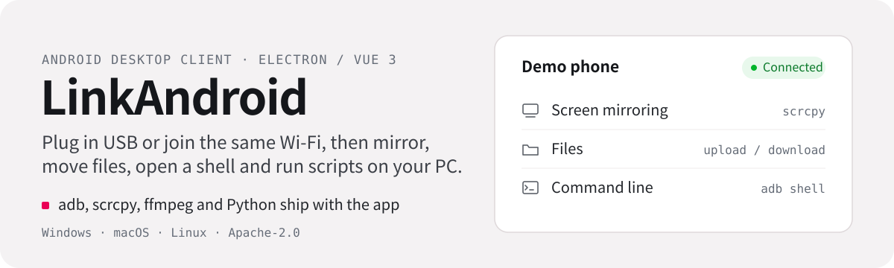
</p>

<p align="center">
  <a href="https://linkandroid.com"><strong>Download</strong></a> ·
  <a href="https://github.com/modstart-lib/linkandroid">GitHub</a> ·
  <a href="https://gitee.com/modstart-lib/linkandroid">Gitee</a> ·
  <a href="https://gitcode.com/modstart-lib/linkandroid">GitCode</a> ·
  <a href="./README.md">简体中文</a>
</p>

<p align="center">
  
  
  
  
</p>

LinkAndroid is an Electron desktop client that connects an Android phone to your computer over adb. Pair it with a USB cable, a QR code, a 6-digit code, an IP address or LAN discovery; once connected, screen mirroring, screenshots and recording, files, apps and a shell all live in one window.

Repetitive work can be written as Python tasks and put on a schedule, or triggered from the CLI and the local HTTP API.

## Install and connect

Installers for Windows, macOS and Linux are on [linkandroid.com](https://linkandroid.com).

1. Enable Developer options → USB debugging, plug in the cable, tap Allow on the phone
2. The phone appears as a card on the Devices page
3. Click the mirror icon on the card; the screen opens in its own window with mouse and keyboard control

adb, scrcpy, ffmpeg and the Python environment for tasks ship with the app, so there is no separate platform-tools install.

## The interface

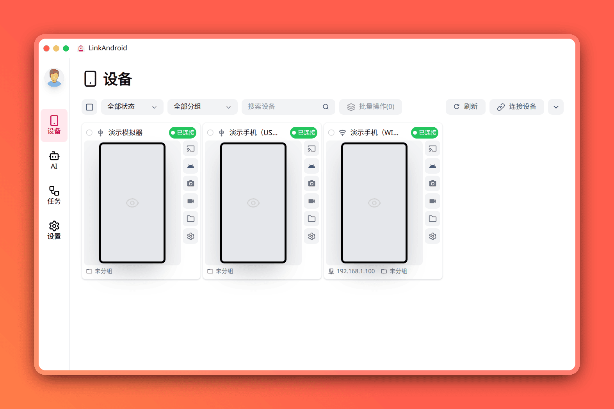

The Devices page is the main screen. The rail on the left is navigation; each device card carries six icons for mirroring, camera, screenshot, recording, files and device settings, and the more menu adds a command line, pinning and connection switching. Connected devices show a green Connected badge, wireless ones show their IP, and with many phones you can group them and filter by state or group above the list. The interface ships in Chinese and English, and the theme can be light, dark or follow the system.

## How it works

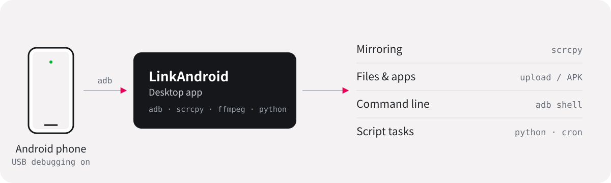

The desktop app talks to the phone over adb. Mirroring runs on scrcpy, recording on ffmpeg, scripts in the bundled virtualenv; they all end up as icons on the device card.

## Connecting a phone

| Method | Steps | Requirements |
| --- | --- | --- |
| USB | Plug in, then tap Allow USB debugging on the phone | Developer options enabled |
| QR pairing | Click QR pairing and scan the code with the phone | Android 11+, same LAN |
| Pairing code | The phone shows a 6-digit code; enter it on the computer | Android 11+, within 60 seconds |
| Direct IP | Enter `IP:port`, for example `192.168.1.100:5555` | Wireless debugging enabled |
| mDNS | Open the connect panel; devices on the subnet appear | Same subnet |

| QR pairing | Pairing code |
|:---:|:---:|
| 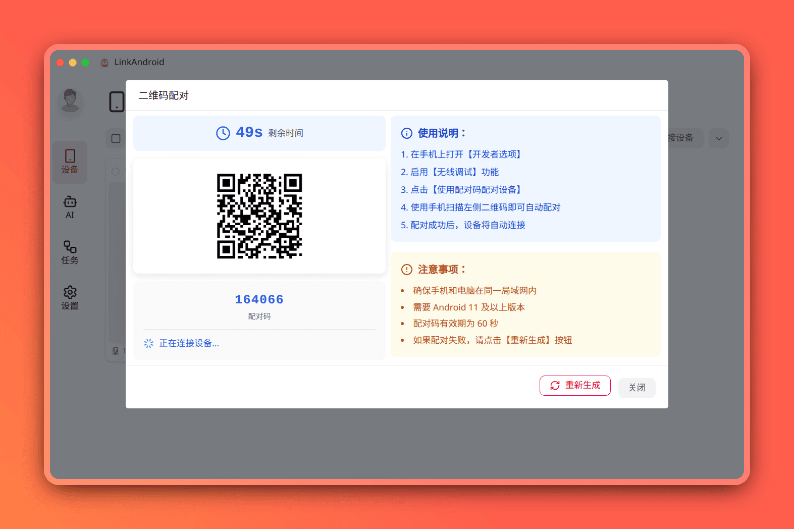 | 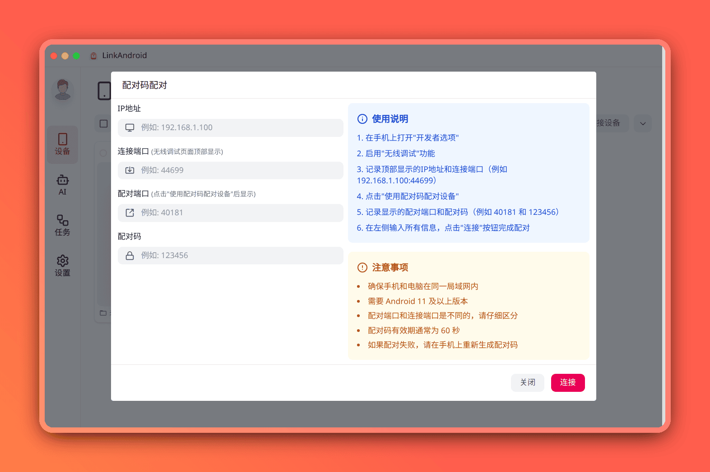 |

## Mirroring and control

Mirroring runs on scrcpy: clicks, scrolling and keystrokes go straight to the phone, and latency and image quality follow the bitrate and frame rate set per device. For native input feel, OTG mode turns the computer into a keyboard and mouse without mirroring.

Settings → Shortcuts binds a key combination to an action: launch an app, tap or long-press a coordinate, repeated taps, swipe, type text, press a panel button. The shortcut fires while the mirror window is focused, other keys still reach the phone, and system shortcuts are left alone.

Device settings apply per phone: auto mirror on connect, turn the screen off while mirroring, always on top, forward audio, show the side panel, block sleep, borderless window; bitrate defaults to 8M and frame rate can be 30 to 240. Custom parameters are appended to the scrcpy command line as-is, for example `--crop 720:1280:0:0`.

Camera mode is a second video source: pick the front or rear camera, resolution, frame rate, zoom and bitrate. In that window, hold Alt (Cmd on macOS) with the arrow keys to rotate, `Shift` with arrow keys to flip, `↑/↓` to zoom, `T` for the torch and `F` for fullscreen.

| Camera settings | Mirroring settings |
|:---:|:---:|
| 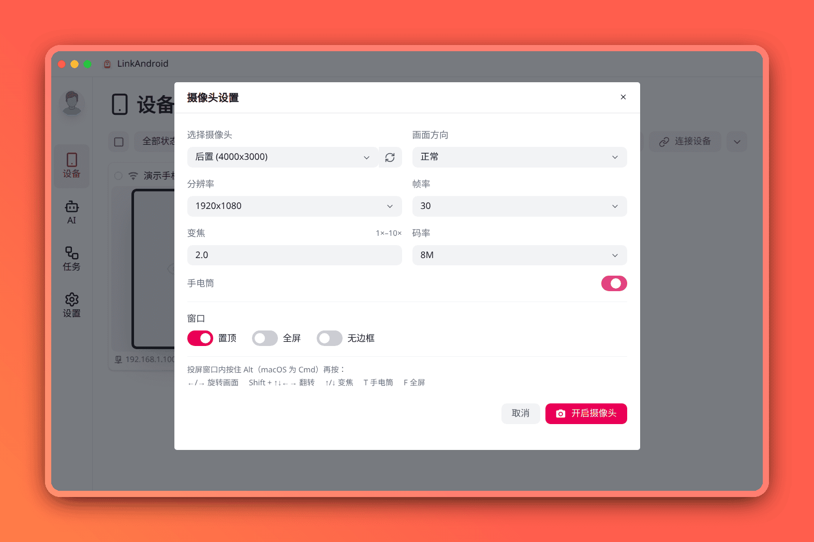 | 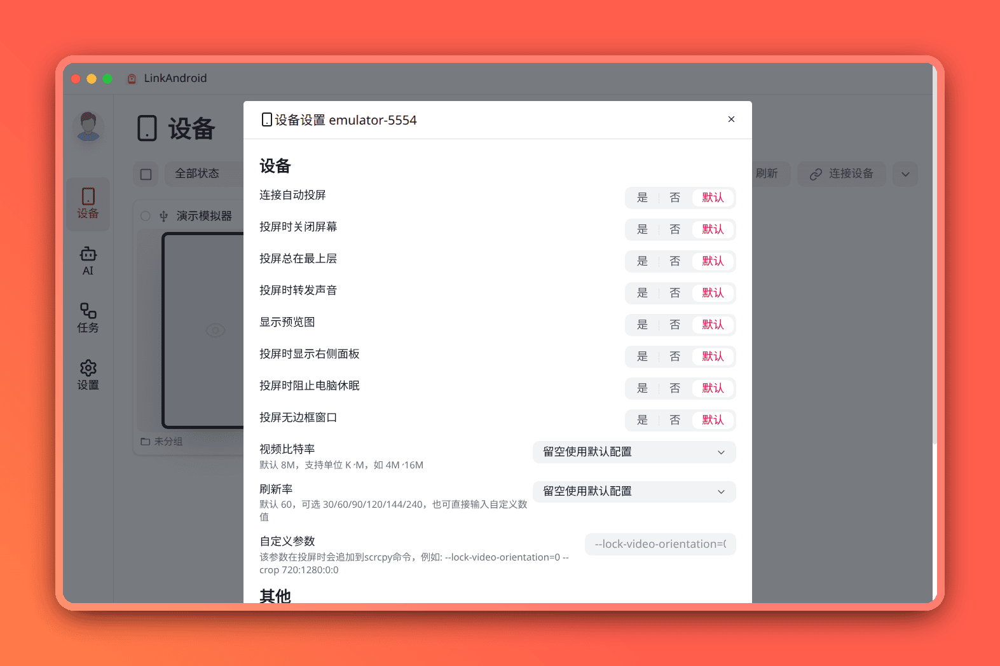 |

## Screenshots and recording

A screenshot opens the built-in beautifier, where you add a device frame and a gradient background before exporting. Recording produces MP4 or GIF, the GIF frame rate is adjustable from 1 to 30 (10 by default), and a single recording is capped at 3 minutes.

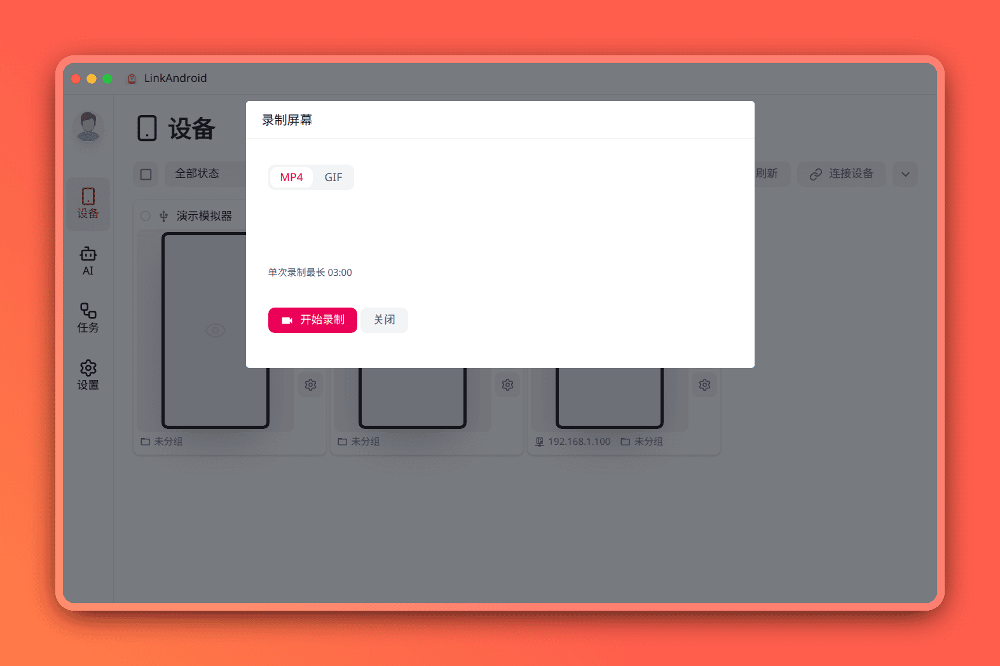

## Files and apps

The file manager has list and grid views and sorts by name, time or size. Upload, download and batch delete sit in the toolbar above the list, and Add file pushes a file from the computer to the phone. App management lists installed apps with their package names and icons, uninstalls them in batches, and installs any APK you pick.

| Files | Apps |
|:---:|:---:|
| 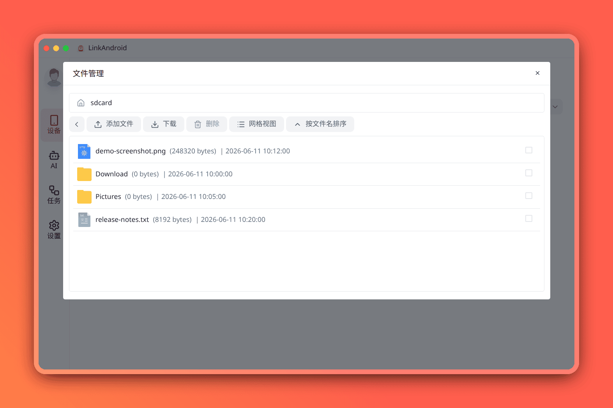 | 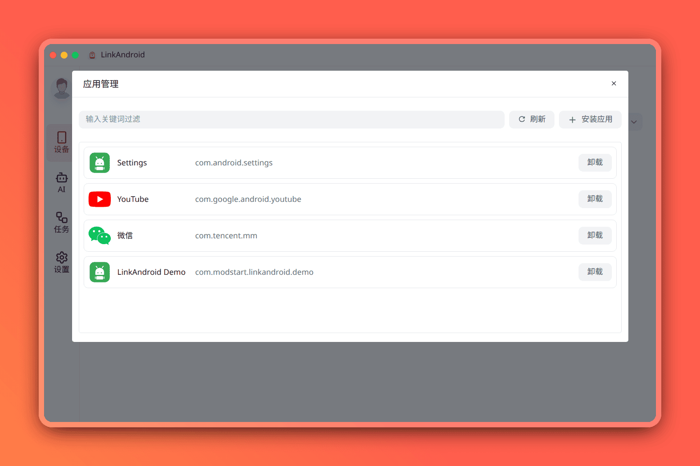 |

## Command line

Pick Command line from the more menu on a device card to get an interactive terminal attached to that phone:

```text
shell@demo:/ $ ls
Download  Pictures  demo-screenshot.png
```

A separate Command tools window runs adb and scrcpy as subcommands; type `help` for usage, `clear` to clear the screen, `exit` to leave.

| Device terminal | Command tools |
|:---:|:---:|
| 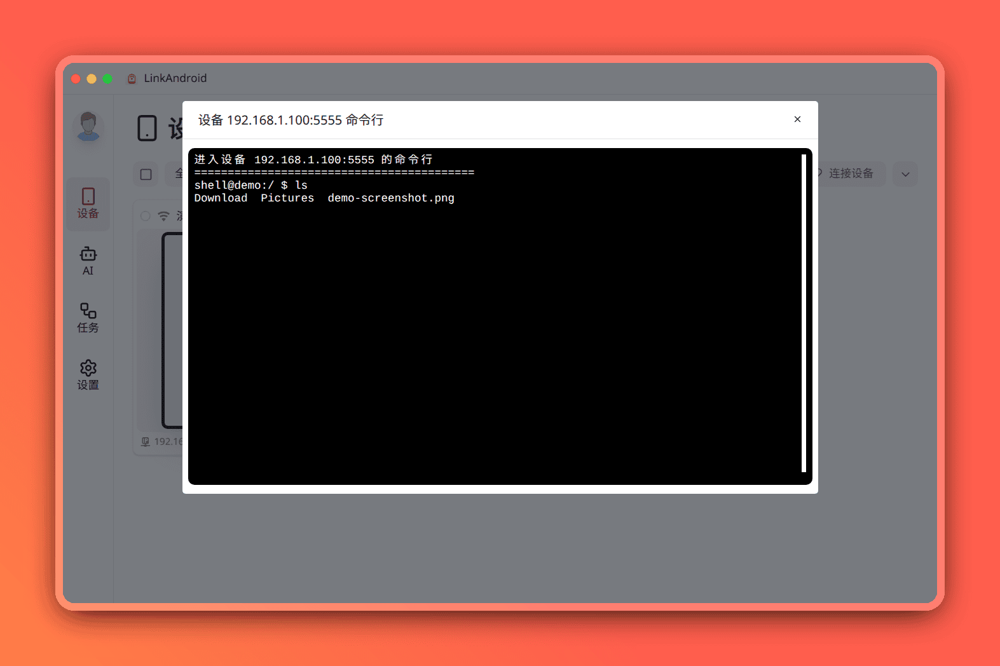 | 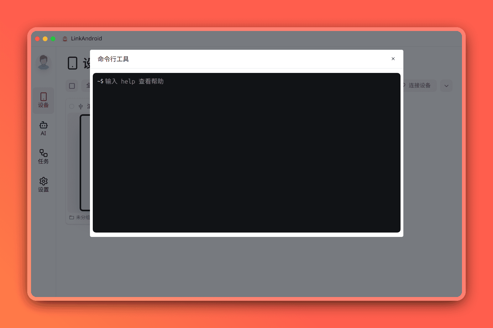 |

## Script tasks

Tasks are Python. The bundled `la` library wraps uiautomator2, so tapping by coordinate or by text, starting and stopping apps, swiping and screenshots are a few lines each:

```python
import la

device = la.device()
device.home()
device.appStart("com.tencent.mm")
la.sleep(3)
device.tapText("Contacts", timeout=5)
```

- Save a task and it can hold several files, with `main.py` as the entry point
- The right panel has three tabs: phone preview, AI edit, developer docs; Run debug executes on the selected phone
- Tasks can run on a cron schedule, across several phones at once, and every run keeps a log
- requests and Pillow are preinstalled, and scripts can call the configured model through `la.llm.call()`

| Task list | Task editor |
|:---:|:---:|
| 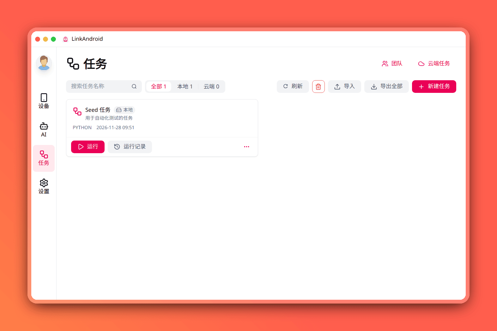 | 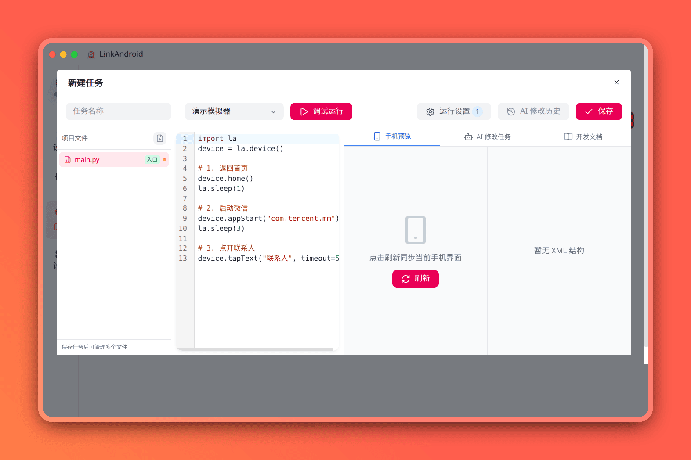 |

## Triggering from outside

The app serves HTTP on local port `53070` with Bearer token auth:

| Endpoint | Description |
| --- | --- |
| `POST /api/devices` | List devices |
| `POST /api/task/list` | List tasks |
| `POST /api/task/get` | Get a task by ID |
| `POST /api/task/run` | Run a task; pass `deviceId`, or it picks the first online phone |
| `POST /api/task/history` | Run history for a task |

```bash
curl -X POST "http://127.0.0.1:53070/api/task/run" \
  -H "Authorization: Bearer $TOKEN" \
  -H "Content-Type: application/json" \
  -d '{"id": 1, "deviceId": "your-device-id"}'
```

The `linkandroid` CLI reads the port and token from `~/.linkandroid/data/cli-auth.json`, so there is nothing to configure:

```bash
linkandroid devices           # list connected devices
linkandroid task list         # list tasks
linkandroid task run <id>     # run a task, --device to pick a phone
linkandroid task history <id> # run history
linkandroid skill             # print the full guide and API reference
```

## AI models

Settings → Models manages providers: the official balance, third-party gateways, or your own API key for OpenAI, DeepSeek, Gemini, Claude, Qwen, Zhipu, and local servers such as Ollama and LM Studio. Configuration for 47+ providers is built in.

Once a model is set, AI edit in the task editor rewrites scripts with it, and `la.llm.call()` inside a script uses the same configuration.

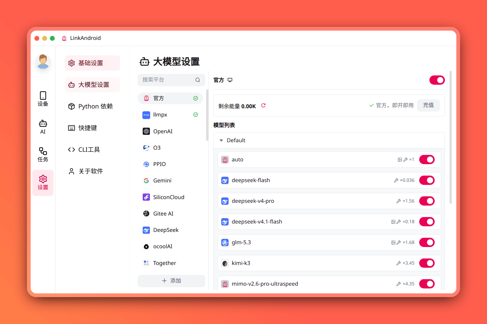

## Development

Node.js 24 is required, and 24 is the only version tested.

```bash
git clone https://github.com/modstart-lib/linkandroid.git
cd linkandroid
npm install
npm run dev            # Vite + Electron
npm run build:preview  # Vite build only, no packaging
npm run build          # full build and package
```

| Command | Description |
| --- | --- |
| `npm run dev` | Dev mode, opens the Electron window |
| `npm run dev:mac` | Kills the previous process first, then starts |
| `npm run build` | Build plus electron-builder packaging |
| `npm run build:mac` / `build:win` / `build:linux` | Package for one platform |
| `make build-cli` | Build the Go `linkandroid` CLI |

There are two halves: `electron/` is the main process, handling adb, scrcpy, files, task scheduling and the HTTP server; `src/` is the Vue 3 + Arco Design renderer, with pages in `src/pages` and feature modules in `src/module`.

## Known limits

- QR and code pairing need Android 11's wireless debugging; older phones use USB or a direct IP
- Wireless connections need the phone and computer on the same LAN, and a pairing code is valid for 60 seconds
- USB debugging has to be on, and its menu path differs between vendors

## Contributing

Issues and pull requests are welcome. Keep `npm run build:preview` passing, and add tests for modules you add or change in the UI.

## Community

> Add the account with the note **LinkAndroid**.

| WeChat group | QQ group |
|:----------:|:---------:|
|  |  |

## License

[Apache-2.0](./LICENSE)
