<div align="center">
  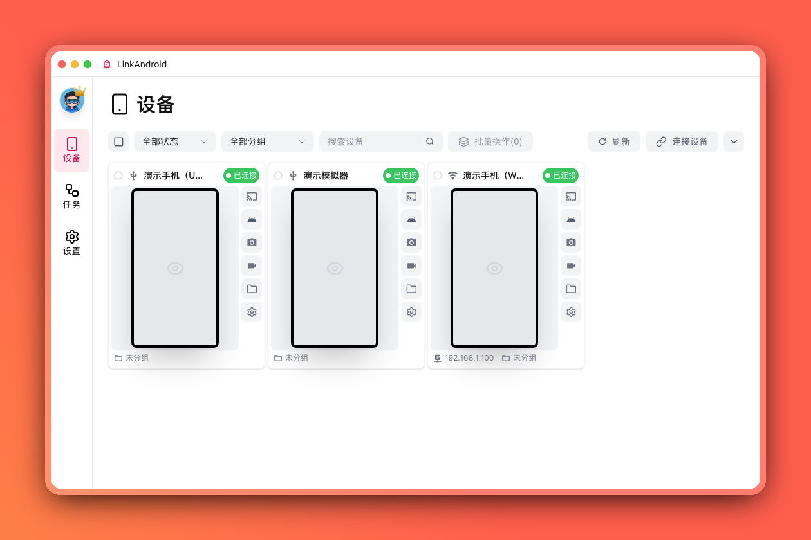
</div>

<h1 align="center">LinkAndroid — オールインワンの Android スマートフォン接続アシスタント</h1>

<div align="center">
  <a href="https://linkandroid.com" target="_blank">
    
  </a>
  
  <a href="https://github.com/modstart-lib/linkandroid" target="_blank">
    
  </a>
  <a href="https://gitee.com/modstart-lib/linkandroid" target="_blank">
    
  </a>
  <a href="https://gitcode.com/modstart-lib/linkandroid" target="_blank">
    
  </a>
  <br/>
  <a href="./README.en-US.md">English</a> · <a href="./README.md">简体中文</a> · <strong>日本語</strong>
</div>

<p align="center">
  <strong>LinkAndroid</strong> は、Electron で作られたクロスプラットフォームのデスクトップアプリケーションで、Android デバイスとコンピューターをシームレスにつなぎます。USB または Wi-Fi で接続すれば、<strong>キーボードとマウスで操作できる画面ミラーリング、スクリーンショットの撮影と装飾、GIF/MP4 での画面録画、ファイルとアプリの管理、ADB Shell コマンドの実行、Python スクリプトによるタスクの自動化、47 以上の AI モデルとの連携</strong>を、1 つの統一されたインターフェースから行えます。
</p>

<p align="center">
  <b>🚀 オープンソース · クロスプラットフォーム · 高機能 · 使いやすい</b>
</p>

---

## 📦 インストール

| プラットフォーム | 手順 |
|----------|-------------|
| **Windows** | [linkandroid.com](https://linkandroid.com) からインストーラーをダウンロードし、ワンクリックでインストールします |
| **macOS** | [linkandroid.com](https://linkandroid.com) から DMG をダウンロードし、ワンクリックでインストールします |
| **Linux** | [linkandroid.com](https://linkandroid.com) から AppImage をダウンロードし、ワンクリックでインストールします |

---

## ✨ 機能

### 🔗 複数デバイスの接続と管理

USB または Wi-Fi で複数の Android デバイスを同時に接続でき、ペアリングの方法も柔軟に選べます。

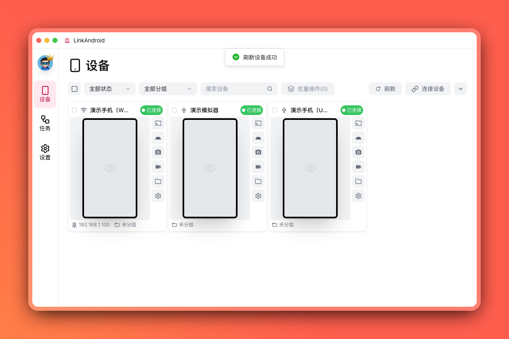

- **USB を挿すだけで接続** — USB で接続したデバイスを自動で検出します
- **ワイヤレス QR ペアリング** — QR コードを読み取って Wi-Fi 経由でペアリングします
- **ペアリングコード** — 6 桁のコードを入力してすばやくペアリングします
- **Wi-Fi 直接接続** — IP:ポートを指定して手動で接続します
- **mDNS による自動検出** — LAN 内の Android デバイスを自動でスキャンします
- **デバイスのグループ化** — デバイスをグループに分けて、すばやく絞り込めます

| QR ペアリング | ペアリングコード | グループ管理 |
|:----------:|:------------:|:----------------:|
| 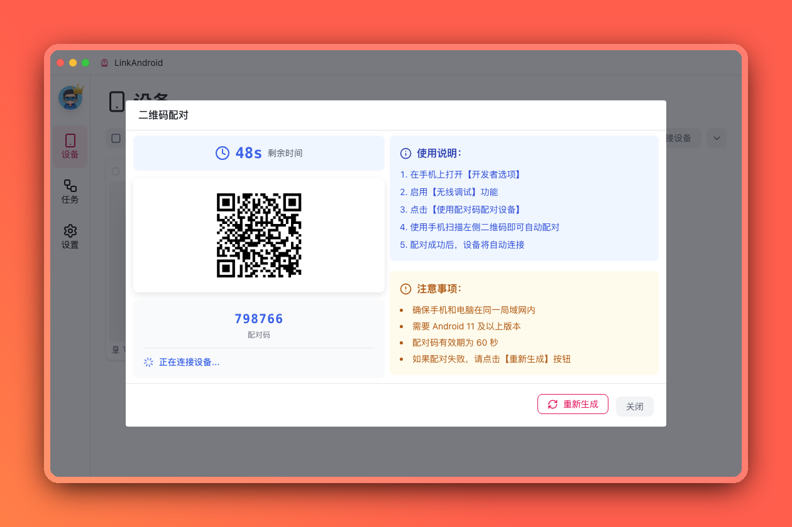 | 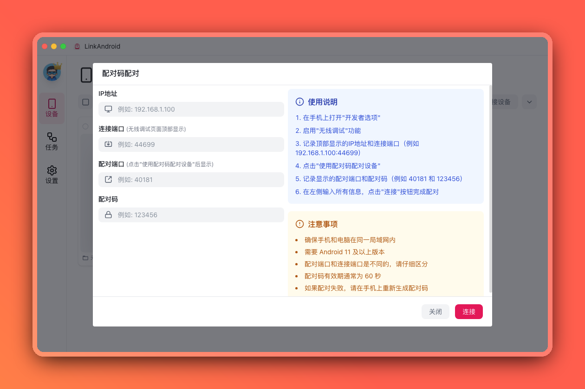 | 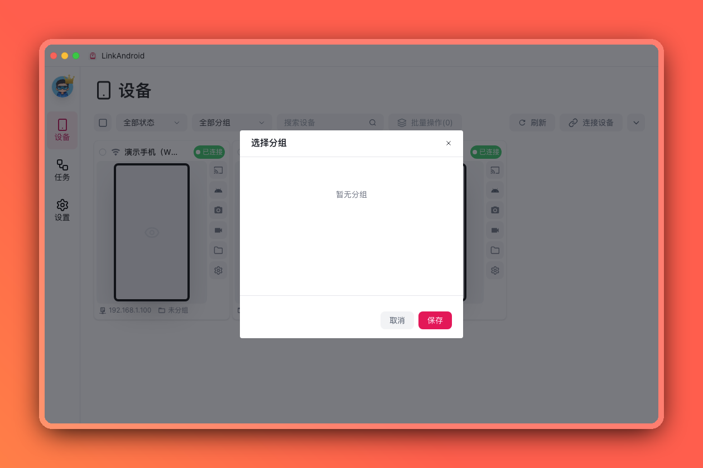 |

### 🖥️ 画面のミラーリングと操作（Scrcpy）

[scrcpy](https://github.com/Genymobile/scrcpy) による低遅延の画面ミラーリングです。キーボードとマウスの入力をすべて転送するので、コンピューターから直接スマートフォンを操作できます。

- **ワンクリックでミラーリング** — 高品質で低遅延の画面キャスト
- **リバースコントロール** — キーボードとマウスでスマートフォンを操作します
- **OTG モード** — PC をキーボード／マウスのエミュレーターにします
- **カメラのストリーミング** — 解像度と FPS を選んで、スマートフォンのカメラを配信します
- **フォローモード** — 複数のデバイスで操作を同期します
- **調整できる設定** — ビットレート、フレームレート、最前面表示、ウィンドウの枠など

| カメラのストリーミング | ミラーリングの設定 |
|:-------------:|:--------------:|
| 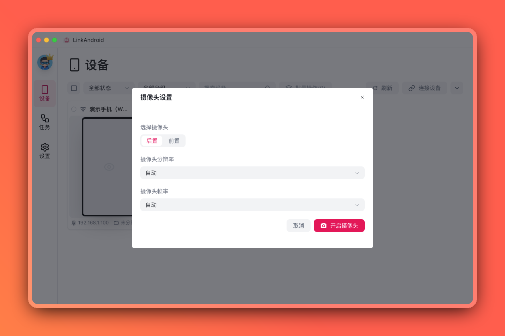 | 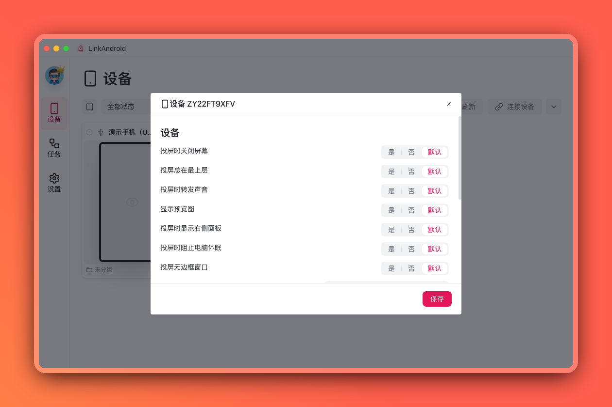 |

### 📸 装飾機能付きのスクリーンショット

ワンクリックでスクリーンショットを撮り、すぐに内蔵の装飾ツールを開いて、デバイスのフレームやグラデーションの背景を加えて仕上げられます。SNS での共有にぴったりです。

### 🎥 GIF / MP4 での画面録画

スマートフォンの画面を **MP4** または **GIF** 形式で録画でき、長さと品質を調整できます。デモ、チュートリアル、バグの再現に最適です。

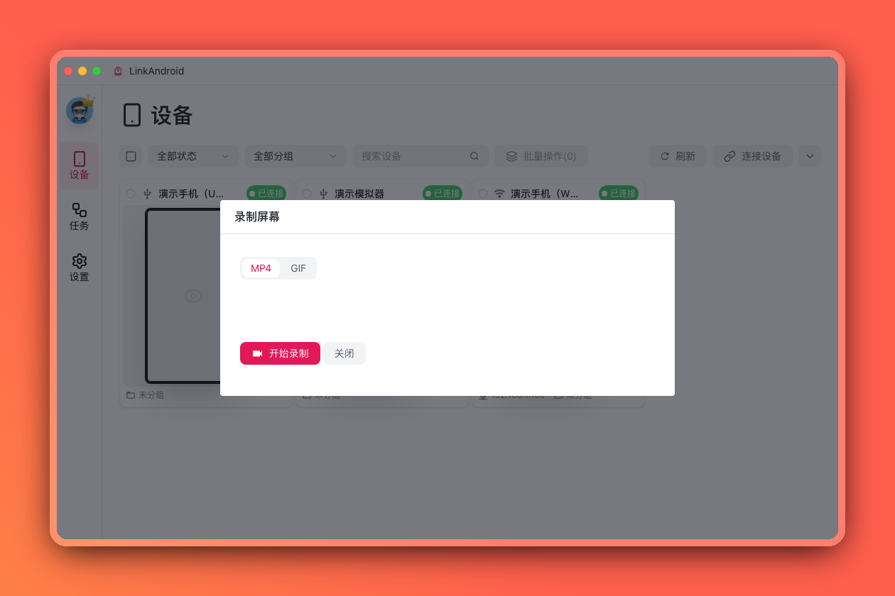

### 📁 ファイルマネージャー

Android デバイス用の高機能なファイルブラウザーです。デスクトップから直接、ファイルのアップロード、ダウンロード、削除、名前の変更ができます。リスト表示とグリッド表示を切り替え、名前、日付、サイズで並べ替えられます。

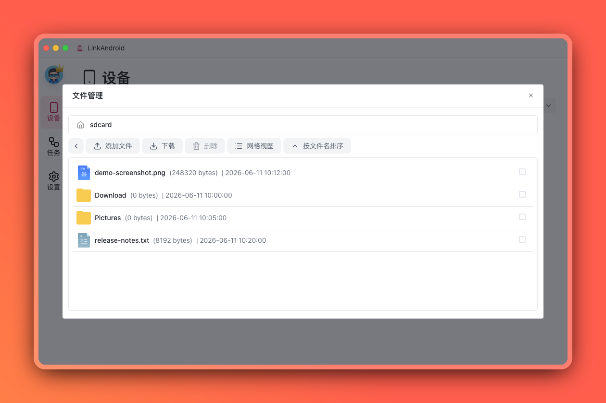

### 📱 アプリマネージャー

インストール済みのアプリをアイコン付きで一覧し、まとめてアンインストールしたり、内蔵のファイル選択から APK ファイルをインストールしたりできます。スマートフォンに触れることなく、すべてを管理できます。

### 💻 コマンドターミナル

すぐに呼び出せるコマンドパレット付きの **ADB Shell** ターミナルを内蔵しています。adb コマンドや Android のシェルコマンドを手軽に実行でき、よく使うコマンドはワンクリックで実行できます。

| ADB Shell | コマンドパレット |
|:---------:|:--------------:|
| 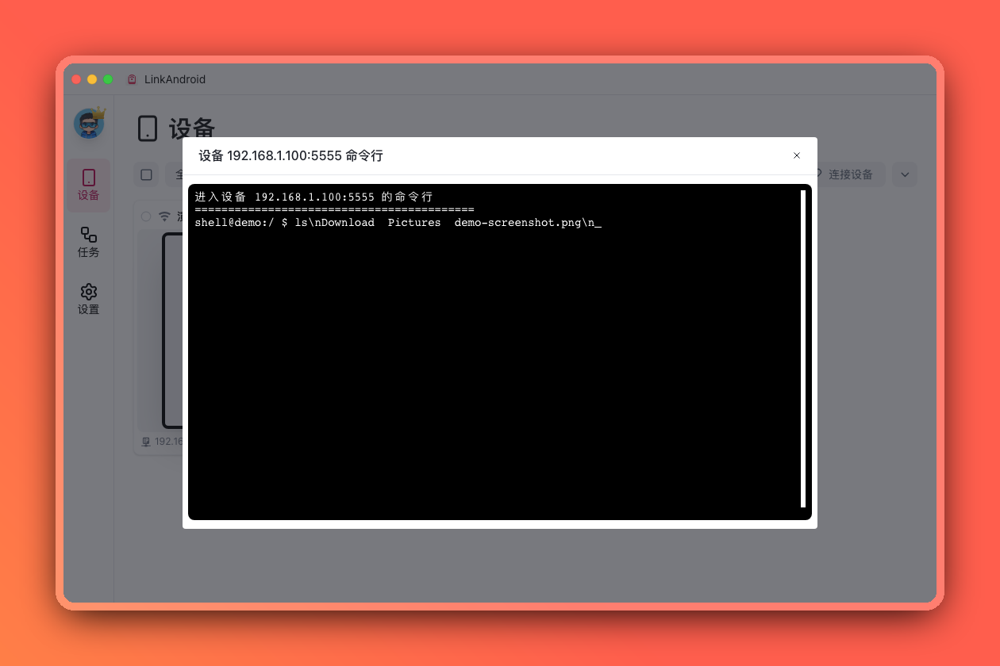 | 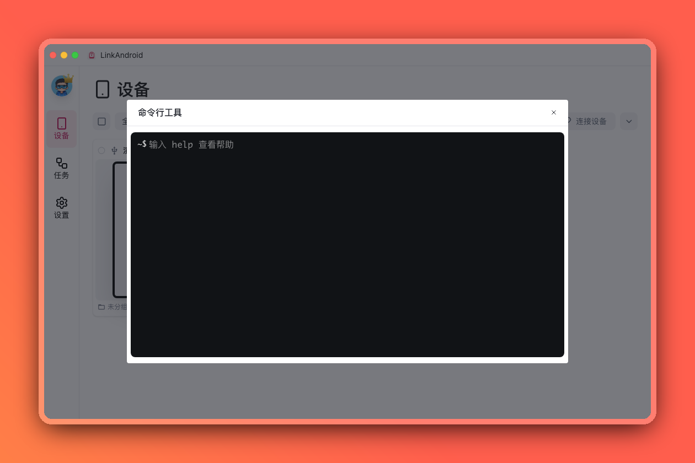 |

### 🤖 スクリプトによる自動化

Python の自動化スクリプトを書いて実行し、1 台または複数のデバイスで一括操作やワークフローを自動化できます。

- **ビジュアルなコードエディター** — シンタックスハイライト付きの内蔵エディター（CodeMirror 6）
- **Cron によるスケジュール** — cron 式を使ってタスクを自動で実行するよう予約します
- **複数デバイスでの実行** — 同じタスクを複数のデバイスで同時に実行します
- **実行ログ** — 詳しいログ付きの、実行の完全な履歴
- **HTTP API** — REST API（ポート 53070）でリモートからタスクを起動します

| タスク一覧 | タスクエディター |
|:---------:|:----------:|
| 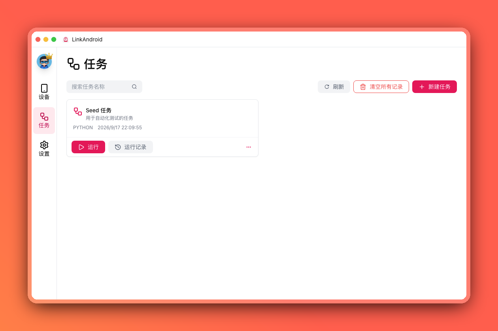 | 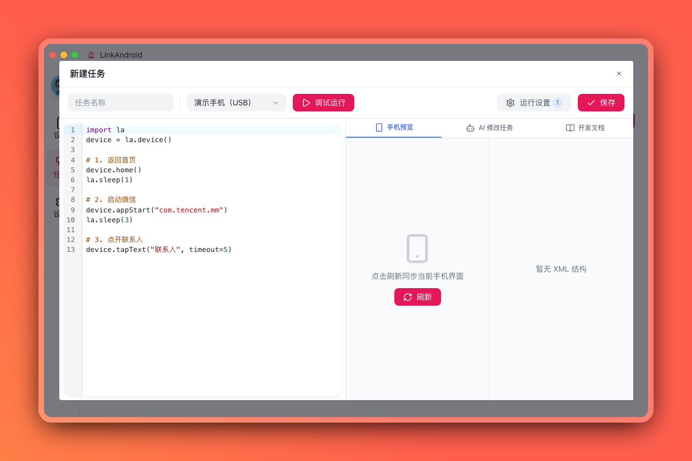 |

### 🌐 CLI でのリモート操作と HTTP API

内蔵の HTTP サーバーが、リモート操作や CI/CD との連携のための RESTful API を提供します：

| エンドポイント | 説明 |
|----------|-------------|
| `POST /api/devices` | 接続中のデバイスを一覧します |
| `POST /api/task/list` | すべてのタスクを一覧します |
| `POST /api/task/get` | ID でタスクを取得します |
| `POST /api/task/run` | リモートからタスクを起動します（`deviceId` は省略可能。省略すると最初のオンラインのデバイスを自動で選びます） |
| `POST /api/task/history` | タスクの実行履歴を表示します |

安全にアクセスするための Bearer Token 認証に対応しています。

### 🧠 AI モデルとの連携

OpenAI、DeepSeek、Zhipu AI、Alibaba Qwen、ローカルの Ollama、Anthropic Claude、Google Gemini など、**47 以上の AI モデルプロバイダー**に標準で対応しています。

- **一元管理** — すべてのプロバイダーの API キーとモデルの設定を 1 か所で管理します
- **AI によるコーディング支援** — タスクエディターの中で、AI の助けを借りてタスクのスクリプトを生成します
- **柔軟なプロンプト** — プロンプトのパラメーター、temperature などを設定できます

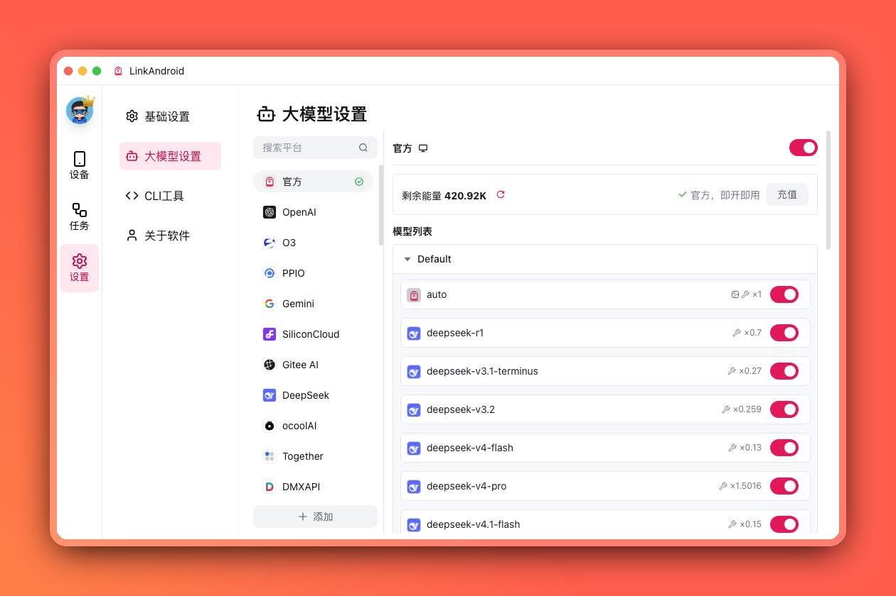

### 🌍 国際化（i18n）

**英語**と**簡体字中国語**に対応し、システムの設定に基づいて言語を自動で判別します。手動での設定は必要ありません。

### 🌗 ダークモード

**Light**、**Dark**、**Follow System** のテーマから選べ、どんな環境でも快適に表示できます。

---

## 🖼️ その他のスクリーンショット

| デフォルトのデバイス設定 | Wi-Fi 接続 | 設定 | 情報 |
|:----------------------:|:----------------:|:--------:|:-----:|
| 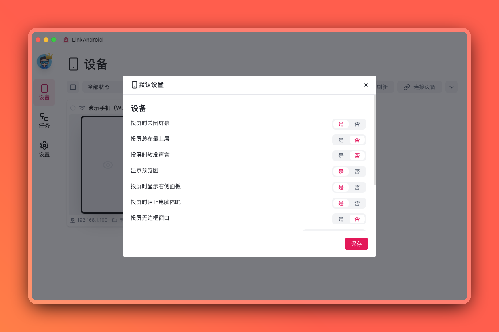 | 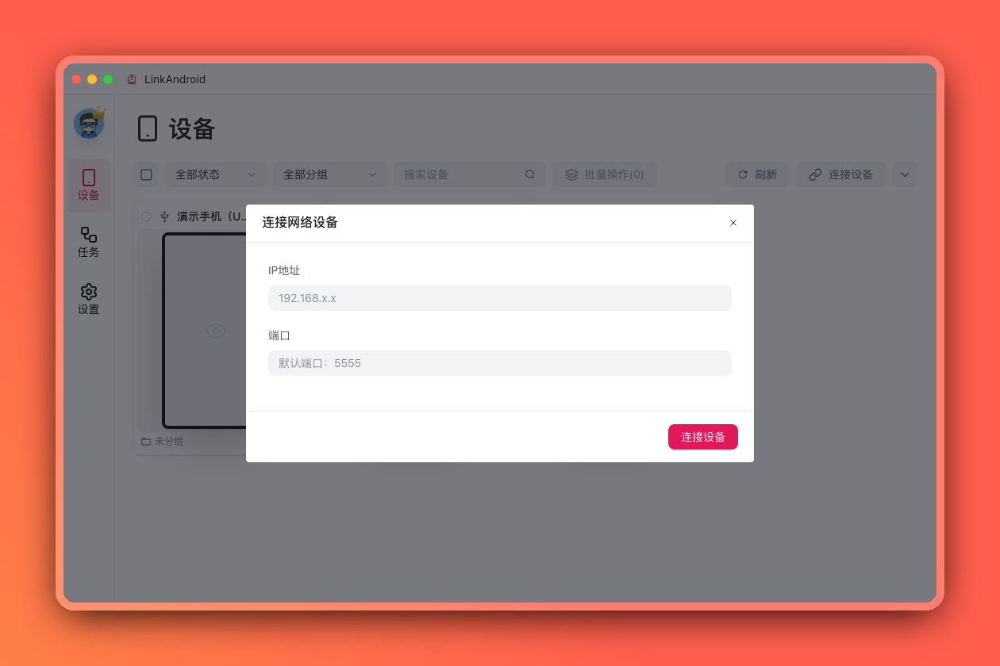 | 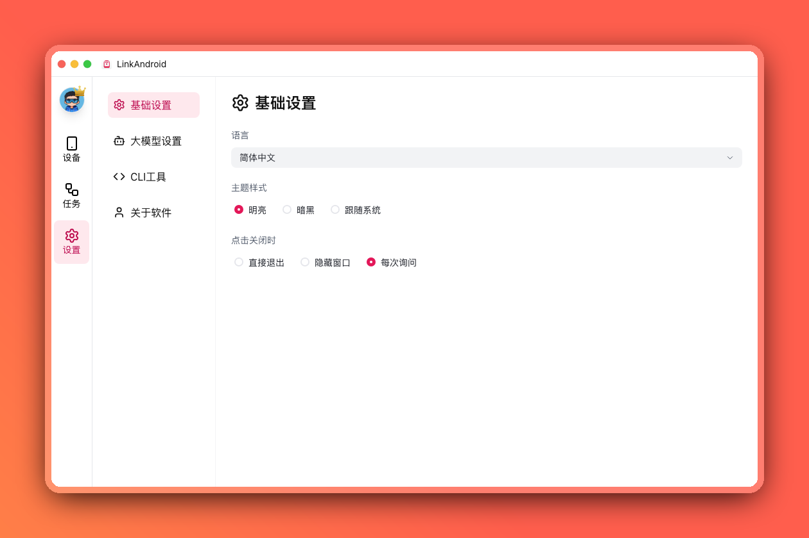 | 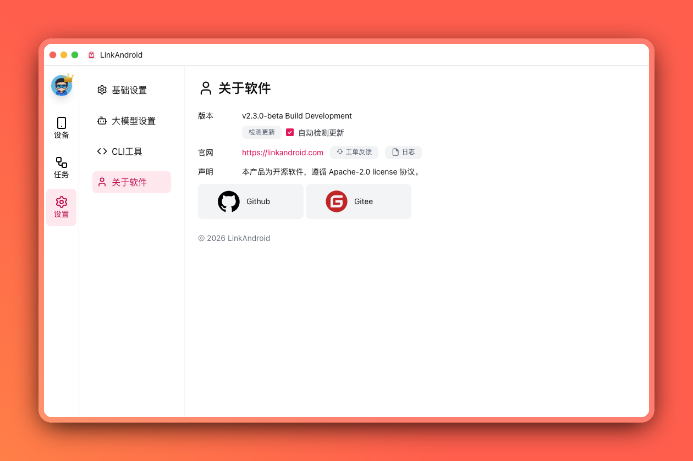 |

---

## 🚀 開発

> **Node.js 20** でのみテストしています。

```bash
# Clone the repository
git clone https://github.com/modstart-lib/linkandroid.git
cd linkandroid

# Install dependencies
npm install

# Start development mode (launches Electron window)
npm run dev

# Build for production
npm run build

# Preview build (Vite build only, no packaging)
npm run build:preview
```

### 利用できるコマンド

| コマンド | 説明 |
|---------|-------------|
| `npm run dev` | Vite の開発サーバーと Electron を起動します |
| `npm run dev:mac` | 既存のプロセスを終了してから開発モードを起動します（macOS） |
| `npm run build:preview` | コードのフォーマットチェックと Vite のビルド |
| `npm run build` | 完全なビルドと electron-builder によるパッケージング |
| `npm run build:mac` | macOS 向けにパッケージングします |
| `npm run build:win` | Windows 向けにパッケージングします |
| `npm run build:linux` | Linux 向けにパッケージングします |
| `npm run format` | Prettier でコードを整形します |

---

## 🤝 コントリビューション

コントリビューション、issue、機能のリクエストを歓迎します！

1. リポジトリをフォークします
2. 機能のブランチを作成します（`git checkout -b feature/amazing-feature`）
3. 変更をコミットします（`git commit -m 'feat: add amazing feature'`）
4. ブランチに push します（`git push origin feature/amazing-feature`）
5. Pull Request を作成します

---

## 💬 コミュニティ

> 友だちに追加するときは、メッセージに **LinkAndroid** と書いてください

| WeChat グループ | QQ グループ |
|:------------:|:--------:|
|  |  |

---

## 📄 ライセンス

このプロジェクトは [Apache-2.0](./LICENSE) License のもとで公開されています。
