<p align="center">
  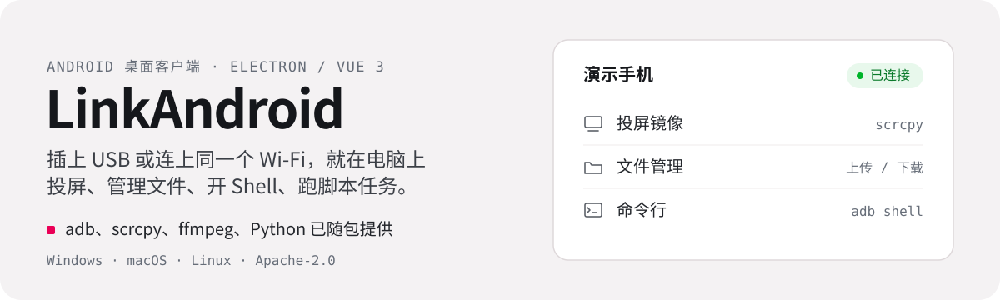
</p>

<p align="center">
  <a href="https://linkandroid.com"><strong>下载安装包</strong></a> ·
  <a href="https://github.com/modstart-lib/linkandroid">GitHub</a> ·
  <a href="https://gitee.com/modstart-lib/linkandroid">Gitee</a> ·
  <a href="https://gitcode.com/modstart-lib/linkandroid">GitCode</a> ·
  <a href="./README.en-US.md">English</a>
</p>

<p align="center">
  
  
  
  
</p>

LinkAndroid 是一个 Electron 桌面客户端，用 adb 把 Android 手机接到电脑上。USB 插线、扫码配对、6 位配对码、IP 直连、局域网自动发现都能连；接上之后，投屏、截屏录屏、文件、应用、Shell 都在同一个窗口里。

重复性的操作可以写成 Python 任务交给它定时跑，也能从命令行或 HTTP 接口远程触发。

## 装好，连上

安装包在 [linkandroid.com](https://linkandroid.com) 下载，Windows、macOS、Linux 各一份。

1. 手机上打开「开发者选项 → USB 调试」，插上数据线，弹窗里点「允许」
2. 「设备」页出现设备卡片
3. 点卡片上的投屏图标，手机画面出现在独立窗口里，鼠标键盘直接操作

adb、scrcpy、ffmpeg 和任务用的 Python 环境都在安装包里，不用另外装 platform-tools。

## 界面

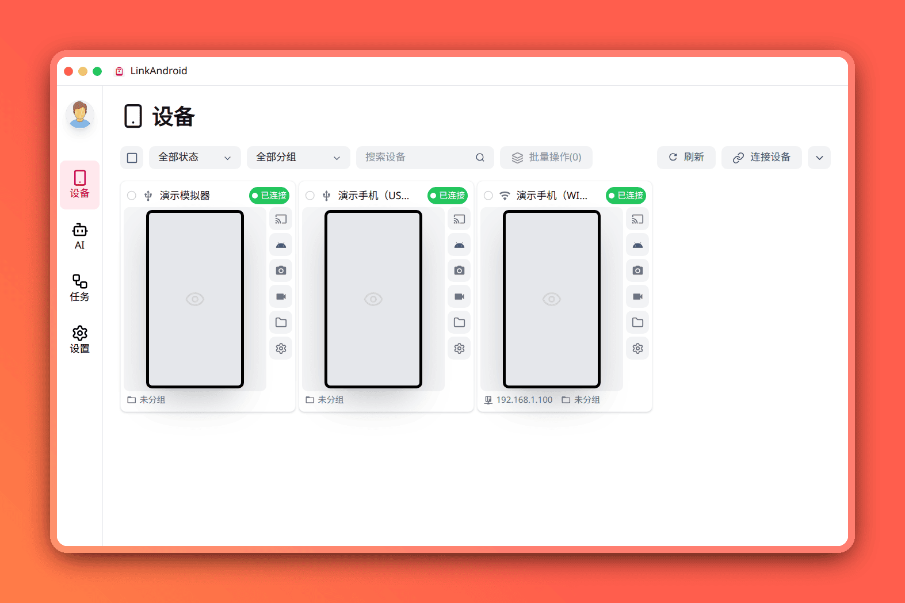

设备页是主界面。左边是导航，中间一排设备卡片，卡片右侧一列图标依次是投屏、摄像头、截屏、录屏、文件管理、设备设置，更多菜单里还有命令行、置顶和连接方式切换。已连接的设备带绿色「已连接」标签，无线连上的会显示 IP 地址。设备多的时候可以分组，列表上方按状态和分组筛选。界面有简体中文和 English，主题可选浅色、深色或跟随系统。
## 怎么工作

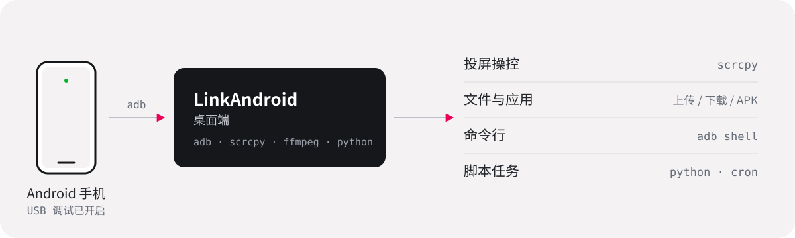

桌面端通过 adb 和手机通信，投屏交给 scrcpy，录制交给 ffmpeg，Python 脚本跑在自带的虚拟环境里；它们最后都变成设备卡片上的图标。

## 连接手机

| 连接方式 | 操作 | 前提 |
| --- | --- | --- |
| USB | 插线后在手机上点「允许 USB 调试」 | 开发者选项已打开 |
| 二维码配对 | 点「二维码配对」，用手机扫窗口里的码 | Android 11 及以上，同一局域网 |
| 配对码 | 手机显示 6 位配对码，在电脑上输入 | Android 11 及以上，60 秒内输完 |
| IP 直连 | 填 `IP:端口`，如 `192.168.1.100:5555` | 手机已开无线调试 |
| mDNS | 打开连接面板，同网段设备会自己出现 | 同一网段 |

| 扫码配对 | 配对码连接 |
|:---:|:---:|
| 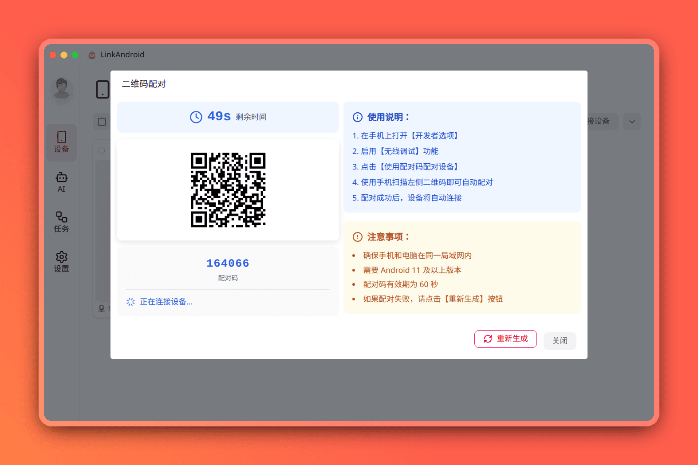 | 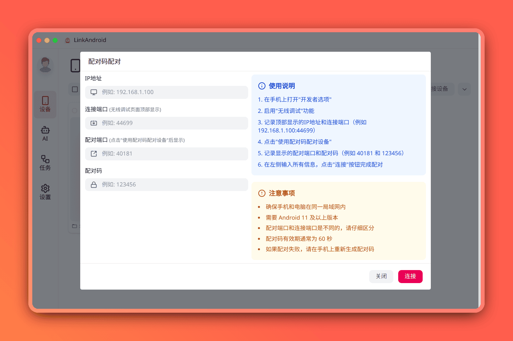 |

## 投屏与操作

投屏用的是 scrcpy，鼠标点击、滚轮滑动、键盘输入都直接作用在手机上，延迟和画质取决于设备设置里的码率和刷新率。需要原生输入手感时用 OTG 模式，电脑只当键鼠，不投屏。

「设置 → 快捷键」可以把组合键绑到动作上：启动指定 App、点击或长按某个坐标、连点、滑动、输入文字、触发面板按钮。投屏窗口聚焦时按组合键触发，其余按键照常输入到手机，也不占用系统快捷键。

设备设置逐台生效：自动投屏、投屏时熄屏、总在最上层、转发声音、显示右侧面板、阻止电脑休眠、无边框窗口；码率默认 8M，刷新率可选 30 到 240。`自定义参数` 会原样拼进 scrcpy 命令行，比如 `--crop 720:1280:0:0`。

摄像头模式把手机摄像头当成一路视频源：可选前后摄像头、分辨率、帧率、变焦和码率。窗口里按住 Alt（macOS 是 Cmd）再配合方向键旋转画面，`Shift + 方向键` 翻转，`↑/↓` 变焦，`T` 开关手电筒，`F` 全屏。

| 摄像头投屏 | 投屏参数 |
|:---:|:---:|
| 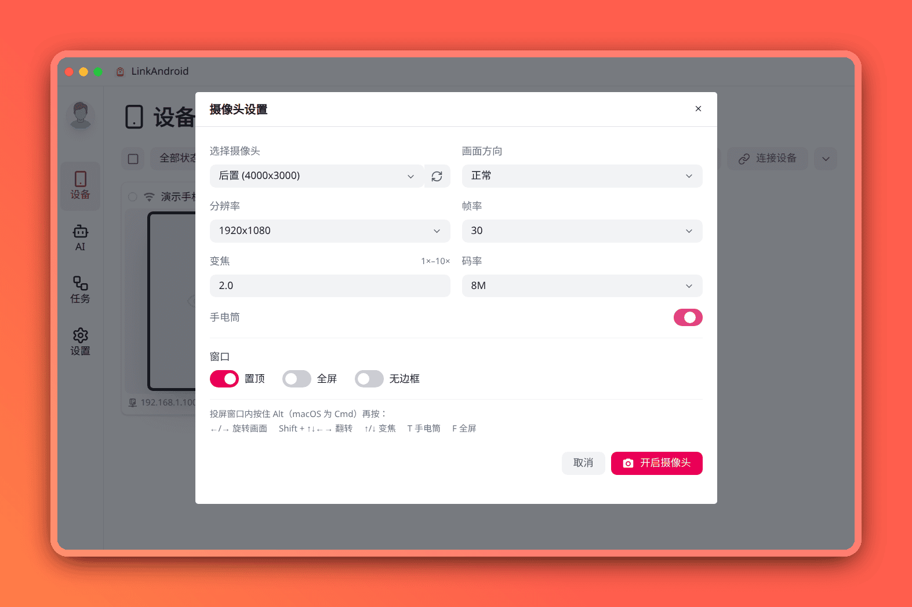 | 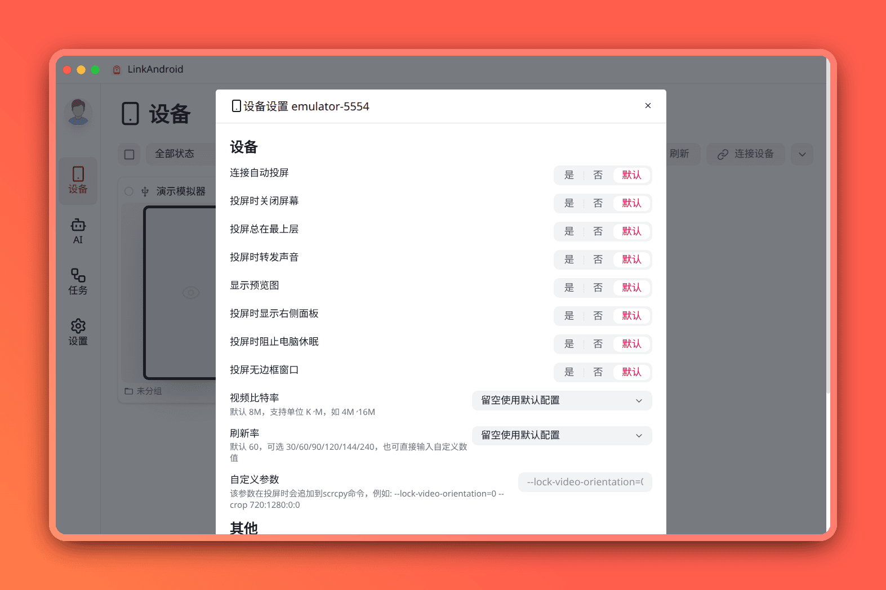 |

## 截屏与录屏

截屏后会跳到内置的美化页，给截图套上设备边框、换渐变背景，导出就能直接发。录屏可选 MP4 或 GIF，GIF 的帧率在 1 到 30 之间调（默认 10），单次录制上限 3 分钟。

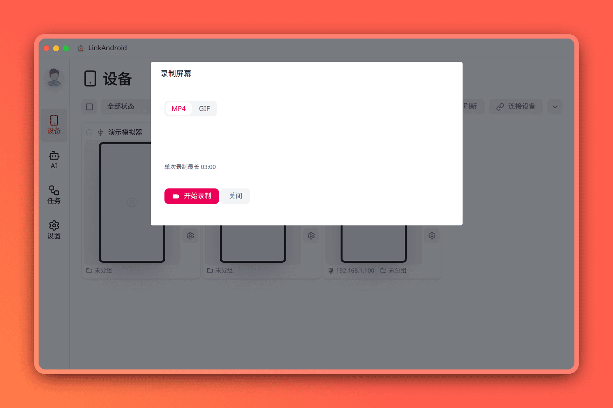

## 文件与应用

文件管理器有列表和网格两种视图，可按名称、时间、大小排序。上传、下载、批量删除在文件列表上方的工具栏，「添加文件」把电脑上的文件推到手机。应用管理列出已装应用的名称、包名和图标，勾选后批量卸载；「安装应用」挑一个 APK 就装上。

| 文件管理 | 应用管理 |
|:---:|:---:|
| 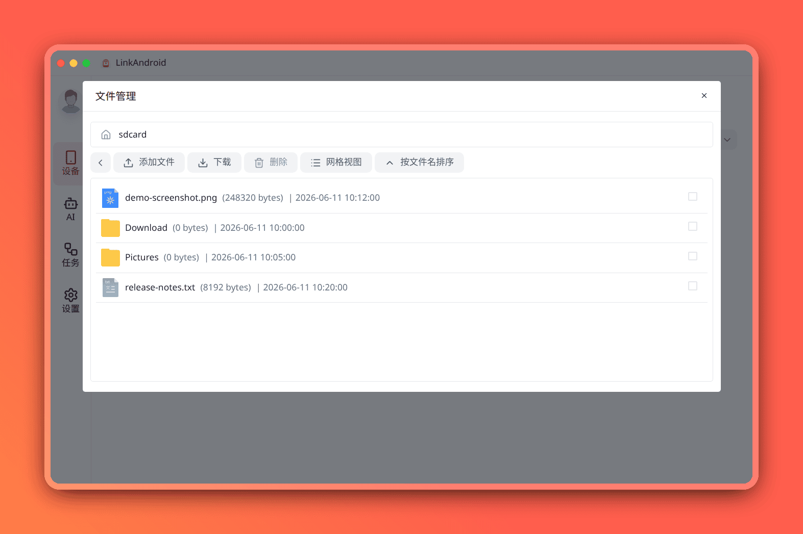 | 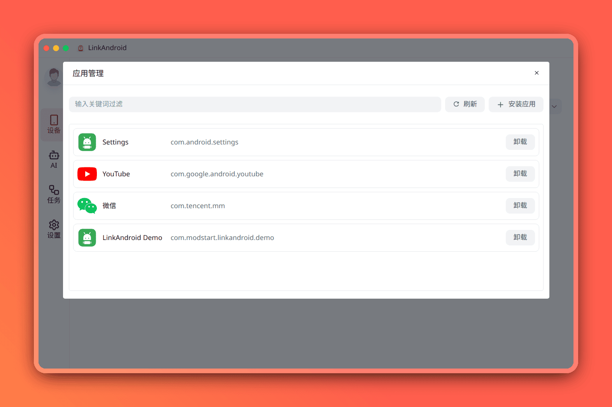 |

## 命令行

设备卡片右上角的更多菜单里选「命令行」，打开的是一个交互式终端，直接连在这台设备上：

```text
shell@demo:/ $ ls
Download  Pictures  demo-screenshot.png
```

还有一个「命令行工具」窗口，用子命令的方式跑 adb 和 scrcpy，输 `help` 看用法，`clear` 清屏，`exit` 退出。

| 设备终端 | 命令行工具 |
|:---:|:---:|
| 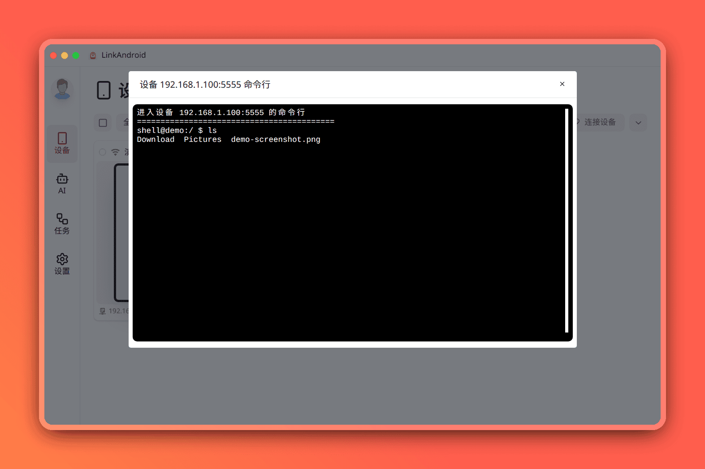 | 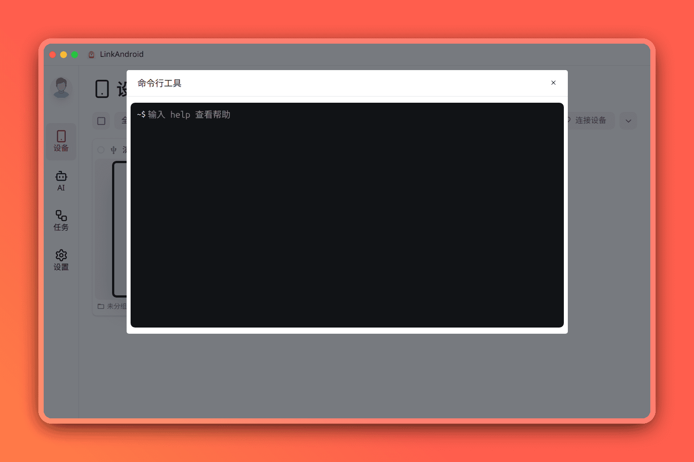 |

## 脚本任务

任务用 Python 写，内置的 `la` 库封装了 uiautomator2，坐标点击、按文字点击、启停应用、滑动截屏都是几行代码：

```python
import la

device = la.device()
device.home()
device.appStart("com.tencent.mm")
la.sleep(3)
device.tapText("联系人", timeout=5)
```

- 保存任务后可以加多个文件，`main.py` 是入口
- 编辑器右侧面板有三个标签页：手机预览、AI 修改任务、开发文档；「调试运行」直接在选中的设备上跑
- 任务可以设 Cron 定时、选多台设备同时执行，每次运行都留日志
- 环境里预装了 requests、Pillow，脚本里还能通过 `la.llm.call()` 调配置好的大模型

| 任务列表 | 任务编辑器 |
|:---:|:---:|
| 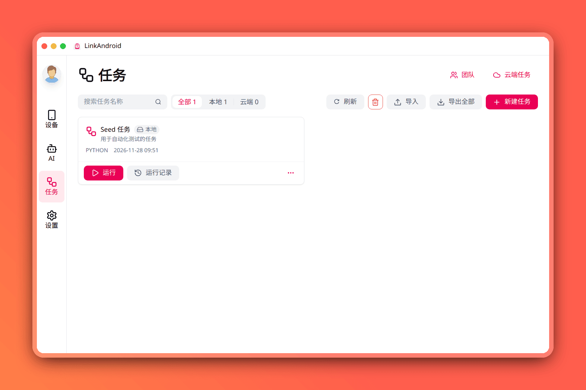 | 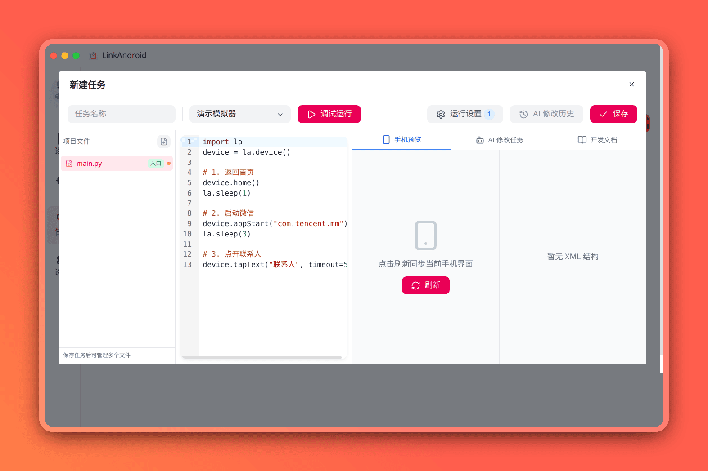 |

## 从外部触发

应用在本地 `53070` 端口起了一个 HTTP 服务，用 Bearer Token 认证：

| 接口 | 说明 |
| --- | --- |
| `POST /api/devices` | 设备列表 |
| `POST /api/task/list` | 任务列表 |
| `POST /api/task/get` | 按 ID 查任务 |
| `POST /api/task/run` | 运行任务，可传 `deviceId`，不传自动选第一台在线设备 |
| `POST /api/task/history` | 任务运行历史 |

```bash
curl -X POST "http://127.0.0.1:53070/api/task/run" \
  -H "Authorization: Bearer $TOKEN" \
  -H "Content-Type: application/json" \
  -d '{"id": 1, "deviceId": "your-device-id"}'
```

配套的命令行工具 `linkandroid` 会自己从 `~/.linkandroid/data/cli-auth.json` 读端口和 token，不用手工配置：

```bash
linkandroid devices           # 列出已连接设备
linkandroid task list         # 列出任务
linkandroid task run <id>     # 运行任务，--device 指定设备
linkandroid task history <id> # 查看运行记录
linkandroid skill             # 打印完整用法和接口文档
```

## AI 模型

「设置 → 大模型设置」里管理模型：官方提供的额度、第三方网关，或者填自己的 API Key 接 OpenAI、DeepSeek、Gemini、Claude、通义、智谱，也可以指向 Ollama、LM Studio 这类本地服务。目前内置 47+ 家厂商的配置。

配好之后，任务编辑器里的「AI 修改任务」会用它改写脚本，脚本里的 `la.llm.call()` 用的也是同一套配置。

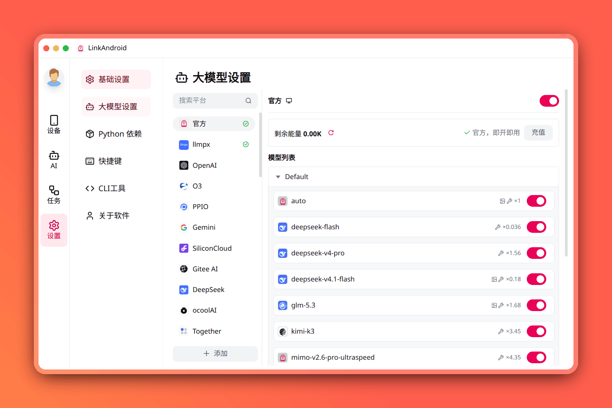

## 本地开发

需要 Node.js 24，只在 24 上测过。

```bash
git clone https://github.com/modstart-lib/linkandroid.git
cd linkandroid
npm install
npm run dev            # 启动 Vite + Electron
npm run build:preview  # 只做 Vite 构建，不打包
npm run build          # 完整构建并打包
```

| 命令 | 说明 |
| --- | --- |
| `npm run dev` | 开发模式，自动打开 Electron 窗口 |
| `npm run dev:mac` | macOS 下先清理进程再启动 |
| `npm run build` | 构建 + electron-builder 打包 |
| `npm run build:mac` / `build:win` / `build:linux` | 指定平台打包 |
| `make build-cli` | 编译 Go 写的 `linkandroid` 命令行工具 |

代码分两块：`electron/` 是主进程，负责 adb、scrcpy、文件、任务调度和 HTTP 服务；`src/` 是 Vue 3 + Arco Design 渲染层，页面在 `src/pages`，功能模块在 `src/module`。

## 已知边界

- 扫码和配对码依赖 Android 11 起的无线调试，低版本只能用 USB 或 IP 直连
- 无线连接要求手机和电脑在同一局域网，配对码 60 秒内有效
- 手机端必须打开 USB 调试，各厂商的开启路径不完全一样

## 参与贡献

欢迎提 Issue 和 Pull Request。改动请保持 `npm run build:preview` 通过，界面上新增或调整的模块补上对应的测试用例。

## 交流群

> 添加好友请备注 **LinkAndroid**

| 微信交流群 | QQ 交流群 |
|:----------:|:---------:|
|  |  |

## License

[Apache-2.0](./LICENSE)
